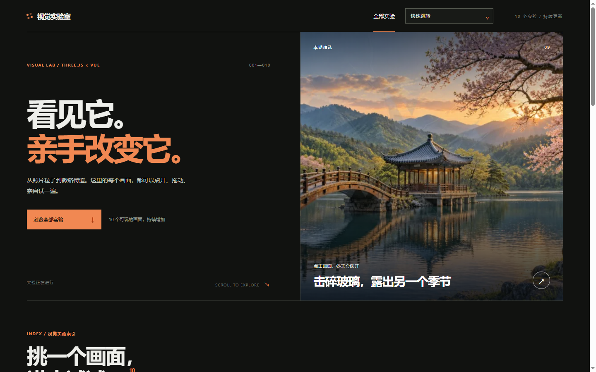
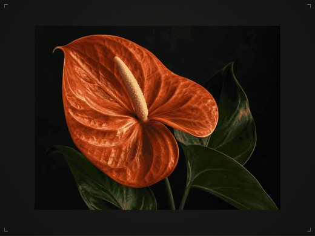
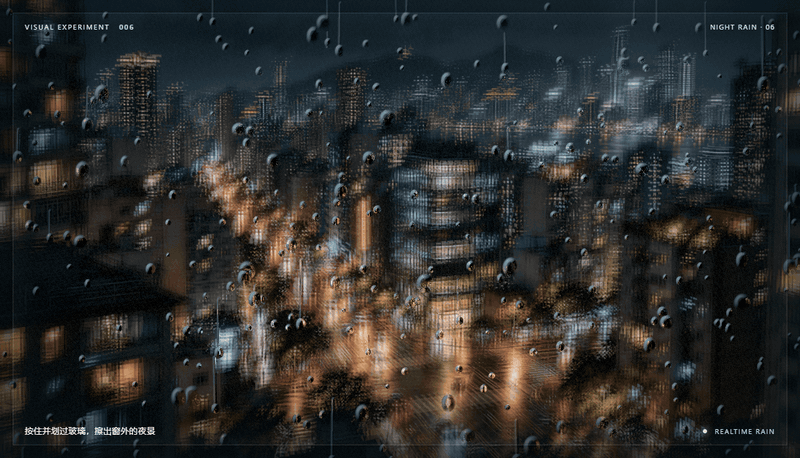
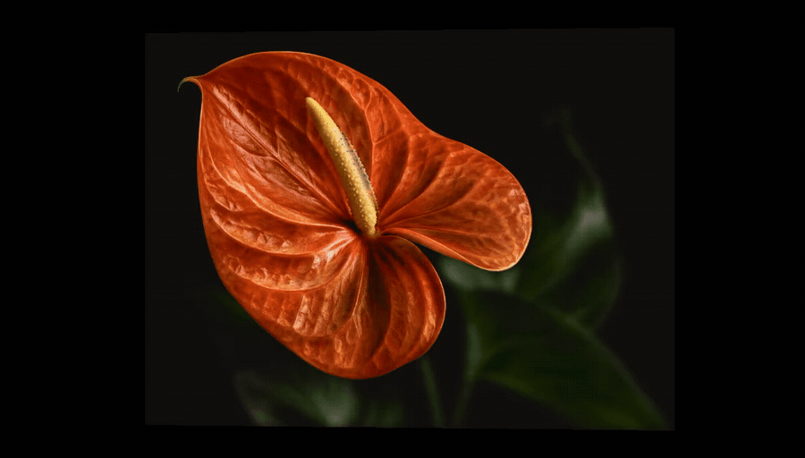
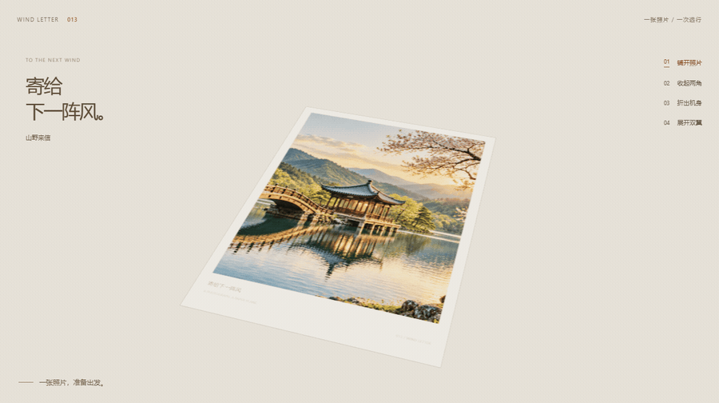
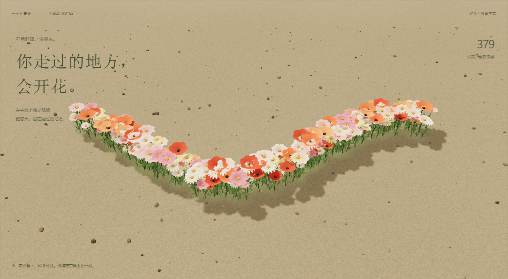

# 视觉实验室 · Three.js 交互特效合集

用 Vue 3、Three.js 和 TypeScript 做成的浏览器交互实验室。目前已完成 **14 个可操作的视觉实验**：让照片消散成粒子、把文字变成烟花、穿越传送门、擦开雨夜玻璃，也可以把照片折成纸飞机，或在荒地上种出一条花路。

每个实验都有独立页面和交互控制，首页提供分类、搜索和排序入口。可以直接体验效果，也可以对照源码了解实现方式。

## 关注公众号

创作不易，感谢支持。扫码关注公众号，继续发掘更多 Three.js 交互特效、实现拆解和作品。

<p align="center">
  
</p>

## 在线预览

> **在线体验：[https://demo.darmk.com.cn//threejsExample/](https://demo.darmk.com.cn//threejsExample/)**

本地启动后打开终端输出的地址即可体验全部实验。建议使用开启硬件加速的现代浏览器；部分效果支持鼠标和触屏操作，具体交互见各实验页面。

## 这个项目完成了什么

### 一个可以浏览、筛选和直接体验的实验目录

首页把 14 个实验分为「图像与材质」「粒子与光」「空间与场景」「数据与叙事」四类，支持按名称、简介和标签搜索，并切换排列顺序。进入实验后可以通过快捷导航继续浏览其他效果。



*首页展示实验封面、分类和搜索入口。*

### 14 个独立的交互实验

下表中的路径是页面的 Hash 路由，接在本地或部署后的站点地址后即可打开对应实验，例如 `http://localhost:5173/threejsExample/#/photo-airplane`。实际端口以启动输出为准。

| 编号 | 实验 | 已完成的效果与操作 | 页面路径 |
| --- | --- | --- | --- |
| 01 | 照片粒子消散与重组 | 鼠标拨开照片局部，点击让粒子散开后重组；支持上传自己的照片和重新播放。 | `#/particle-photo` |
| 02 | 鼠标拨动的液态海报 | 鼠标或触摸制造水纹，点击激起波浪；支持替换图片、调节折射强度和清空水波。 | `#/liquid-poster` |
| 03 | 文字变成烟花 | 输入文字，将笔画采样成光点，经历升空、绽放和重新聚成原句的过程。 | `#/text-fireworks` |
| 04 | 穿越传送门 | 指针轻微改变观察角度，点击后镜头穿过光圈进入另一侧场景，可返回重播。 | `#/portal-journey` |
| 05 | 可交互的星云银河 | 拖拽旋转、滚轮或双指缩放、点击激起星尘波纹；支持切换色谱、调整旋转速度与暂停。 | `#/nebula-galaxy` |
| 06 | 雨夜玻璃窗 | 雨滴沿玻璃滑落，擦拭露出清晰夜景；支持调节雨势、暂停和触发闪电。 | `#/rain-window` |
| 07 | 扫描中的全息地球 | 旋转卫星影像地球，查看云层与扫描光，点击读取经纬度；支持调整速度、暂停与复位。 | `#/holographic-earth` |
| 08 | 无限延伸的霓虹隧道 | 光框、地面光标和粒子循环向前；支持指针调整视角、切换色谱和速度、暂停与发射脉冲。 | `#/neon-tunnel` |
| 09 | 击碎玻璃，露出另一个季节 | 在冬季湖景上点击，裂纹从落点扩散，画面沿不规则边缘露出春景；支持复原重试。 | `#/season-glass` |
| 10 | 一张照片立成微缩街道 | 从俯拍照片过渡到立体街区，展示楼房、道路和小车；支持控制生成进度、旋转观察与重播。 | `#/miniature-city` |
| 11 | 让一张照片有前后层次 | 将照片拆为多个空间平面，转动视角查看遮挡和视差；支持切换焦点、展开图层，以及上传图片编辑分层。 | `#/photo-depth` |
| 12 | 穿过人口潮 | 输入出生年份，在三维人口地形上播放同龄人口随年份的变化；支持切换地区、拖动年份与暂停重播。 | `#/population-tide` |
| 13 | 照片折成纸飞机 | 将照片沿折痕折成纸飞机，按住向后拉再松手放飞；支持替换照片，选择完整显示或铺满纸面。 | `#/photo-airplane` |
| 14 | 鼠标经过，荒地上长出花路 | 鼠标移动或触屏划动种花，花茎生长、花瓣展开并随风摇动；支持两组花色、花路宽度、风、自动示范和清空。 | `#/flower-trail` |

## 效果展示

以下动图使用项目已有的实际渲染素材，展示交互过程；完整操作可在本地页面体验。

### 照片粒子：拨开、消散，再重新聚合

照片被采样成保留原图颜色的点云，指针推动局部粒子，点击后整张照片散开并重组。换成自己的照片，也可以体验同样的交互。



### 雨夜玻璃：擦开水痕，看见窗外

雨滴、水痕和玻璃折射叠加在城市夜景上。擦拭改变局部清晰度，闪电短暂照亮画面。



### 碎玻璃换季：点击落点决定裂纹起点

裂纹从点击位置向外蔓延，冬春景色沿不规则边缘过渡，可以复原后换个位置再次尝试。


### 照片分层：观察真实的遮挡与视差

花蕊、花瓣、叶片与背景分布在不同平面，镜头变化时产生前后层次。上传自己的图片后，可以在编辑界面中制作分层。



### 人口潮：让一代人的变化变成空间轨迹

选择出生年份，沿着年龄与年份构成的三维地形播放轨迹。数据覆盖世界、中国、印度、日本和美国，时间范围为 1950—2026 年。


### 照片纸飞机：从平面照片到折叠与放飞

照片成为纸张正面的纹理，折叠后仍能看到原来的画面。按住向后拉，再松手，纸飞机沿飞行轨迹离开工作台。



### 花路：让指针走过的地方开花

花朵沿操作轨迹依次生长，花路保留在场景中，支持日光野花与暮色花园两组花色。



更多实验截图、动态图和对应教程保存在 [`articles/`](articles/) 中。

## 怎么实现的

页面和控制面板由 **Vue 3** 管理，**Three.js** 负责场景、相机、几何、材质与渲染，**TypeScript** 提供类型约束，**Vite** 负责开发与静态打包。

- **粒子与着色器**：照片粒子、文字烟花和银河通过点云与自定义 Shader 控制位移、颜色和动画；霓虹隧道通过深度循环形成持续前进的效果。
- **纹理与折射**：液态海报用两个渲染目标交替计算波高，读取波高梯度产生折射；雨夜玻璃用雨滴和擦拭纹理控制水痕与清晰度。
- **空间与几何**：照片分层用多个平面产生遮挡和视差，纸飞机通过几何变形完成折叠，花路用 `InstancedMesh` 批量绘制并由着色器驱动生长和摇曳。
- **页面与生命周期**：首页和快捷导航共用实验配置，各实验组件按需加载；组件负责输入与界面联动，渲染类负责效果和资源释放。

### 源码入口

| 内容 | 位置 |
| --- | --- |
| 首页、路由切换与实验控制 | [`src/App.vue`](src/App.vue) |
| 14 个实验的名称、分类、路由与封面配置 | [`src/data/experiments.ts`](src/data/experiments.ts) |
| 各实验交互组件 | [`src/components/`](src/components/) |
| Three.js 渲染与核心效果 | [`src/three/`](src/three/) |
| 页面样式 | [`src/style.css`](src/style.css)、[`src/airplane.css`](src/airplane.css) |
| 图片、地理数据与人口数据 | [`public/`](public/) |
| README 展示图片 | [`docs/images/`](docs/images/) |
| 教程、截图与动态图 | [`articles/`](articles/) |
| 人口数据提取脚本 | [`scripts/build-population-data.mjs`](scripts/build-population-data.mjs) |

## 本地运行

项目使用 pnpm 管理依赖，Node.js 版本可参考 [`.nvmrc`](.nvmrc)（24.19.0）。使用 nvm 时可以先执行 `nvm use 24.19.0`。

```bash
pnpm install
pnpm dev
```

打开终端输出的本地地址。构建和预览生产版本：

```bash
pnpm build
pnpm preview
```

`pnpm build` 会先执行 TypeScript 类型检查，再将静态站点输出到 `dist/`。

## 部署

当前 [`vite.config.ts`](vite.config.ts) 中的部署基础路径为 `/threejsExample/`。将 `dist/` 中的文件部署到站点对应目录即可；如果部署目录不同，需要修改 `base` 后重新构建。图片和数据通过 [`publicAsset`](src/utils/publicAsset.ts) 拼接基础路径。

实验使用 Hash 路由，例如 `/threejsExample/#/season-glass`，切换实验无需服务端处理独立页面路由。

## 素材与数据说明

- 项目内置演示配图；季节图片和微缩城市底图的用途与规格说明分别见 [`public/images/seasons/README.md`](public/images/seasons/README.md) 与 [`public/images/miniature-city/README.md`](public/images/miniature-city/README.md)。
- 全息地球使用 NASA 地球影像与 Natural Earth 陆地数据，云层运动、扫描光和日夜表现由 Three.js 渲染。来源与使用说明见 [`public/data/README.md`](public/data/README.md)。
- 人口潮使用联合国 **World Population Prospects 2024** 数据，其中 1950—2023 年为估计数据，2024—2026 年为中方案预测。轨迹表示沿「年龄—年份」对角线读取的同龄人口数量，不能视为对同一批个体的连续追踪。数据来源、许可和重建方法见 [`public/data/README.md`](public/data/README.md)。
